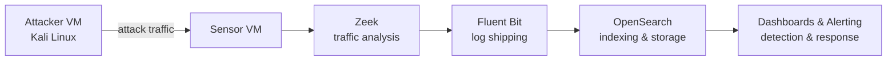
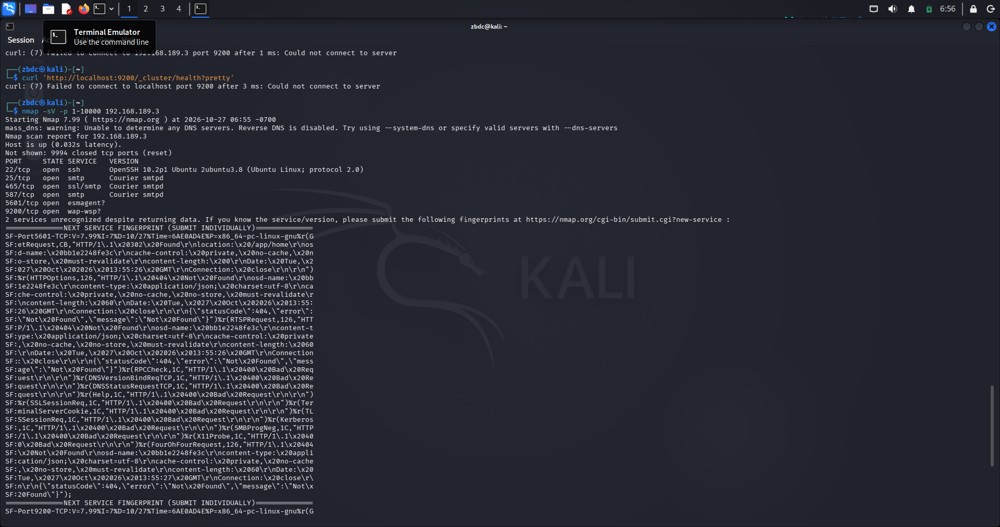
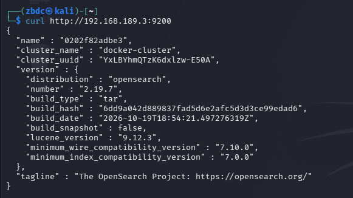
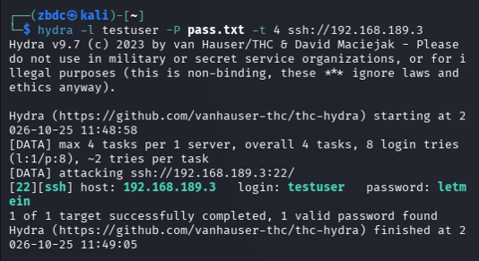
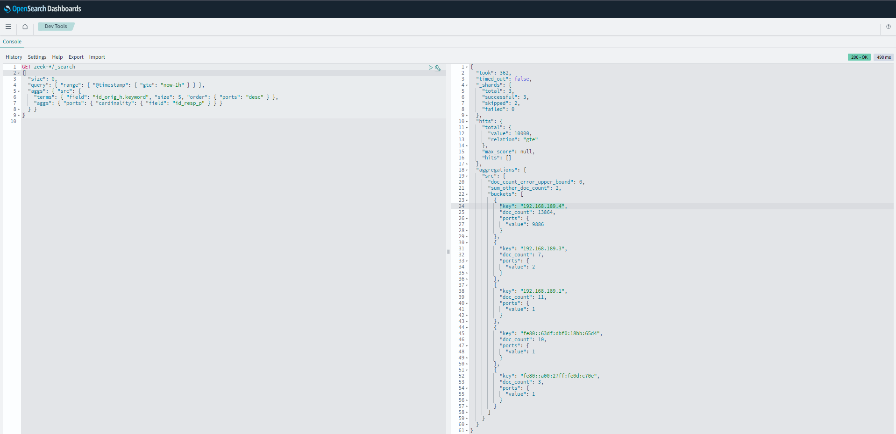
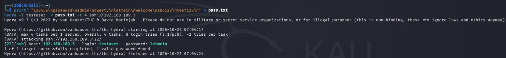
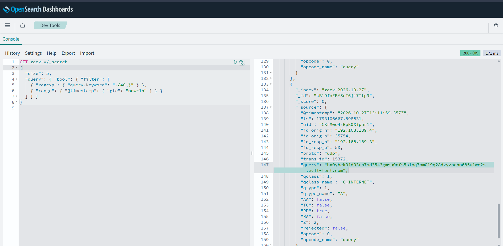
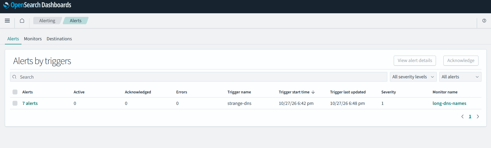
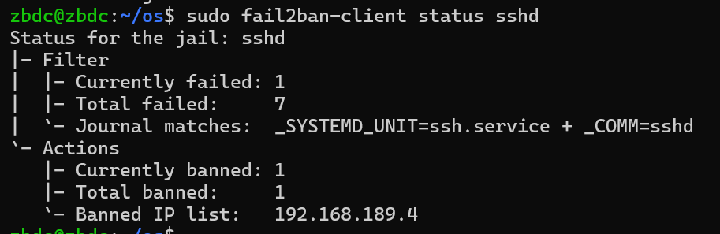

# Network Detection Lab: Zeek + OpenSearch

A self-contained home lab in which I built a network monitoring pipeline, attacked it from a separate machine, detected the attacks using the pipeline I built, and then remediated the underlying weaknesses — validating each fix by re-running the attack.

**In short:** I built the detection capability, found real misconfigurations by attacking my own environment, wrote detections for each attack technique, mapped them to MITRE ATT&CK, then fixed the root causes and proved the fixes held.

---

## 1. Objective

Most introductory security labs stop at "tool is installed, dashboard shows data." I wanted to go through the fuller lifecycle an analyst is actually responsible for:

1. Collect and centralize network telemetry.
2. Simulate realistic attack behavior against the environment.
3. Detect that behavior using the collected data.
4. Identify and remediate the root cause.
5. Validate the fix by re-attacking and confirming failure.

---

## 2. Architecture

Two isolated VirtualBox VMs on a private host-only network — no production or third-party systems were touched.

| Component | Role |
|---|---|
| **Sensor VM** (Ubuntu Server) | Hosts the detection stack. |
| **Zeek** | Network traffic analyzer — generates connection, DNS, and SSH logs. |
| **Fluent Bit** | Log shipper — forwards Zeek's logs to OpenSearch. |
| **OpenSearch** | Stores and indexes the logs; backend for search and alerting. |
| **OpenSearch Dashboards** | Query interface (Dev Tools) and alert management. |
| **Attacker VM** (Kali Linux) | Source of the simulated attacks. |

---

## 3. Reconnaissance: Initial Findings

An initial port scan from the attacker VM against the sensor simulated the reconnaissance phase of an attack.

This scan, combined with manual follow-up, surfaced two confirmed weaknesses.

### Finding 1 — OpenSearch exposed with no authentication

Port `9200` (OpenSearch's API) was reachable from the attacker VM and returned cluster data with no authentication required.

`curl http://<sensor-ip>:9200` from the attacker VM, showing an unauthenticated response

### Finding 2 — Weak SSH credentials

A test account on the sensor was configured with an intentionally weak password to evaluate exposure. A dictionary brute-force attack (Hydra) against SSH recovered the credential within seconds.

Hydra successfully recovering the SSH credential

---

## 4. Detection Engineering

With Zeek logging all connections and Fluent Bit shipping that data into OpenSearch, each attack technique was detected using a targeted query against the collected telemetry.

### Detection 1 — Port scan (T1046, Network Service Discovery)

**Logic:** A single source IP connecting to an unusually high number of distinct destination ports within a short time window is indicative of port scanning. A query aggregating connections by source IP and counting distinct destination ports isolated the attacker VM clearly.

Port-scan detection query and result

### Detection 2 — SSH brute force (T1110, Brute Force)

**Logic:** A legitimate user authenticates to SSH infrequently. A brute-force tool generates a high volume of connection attempts to port 22 in a short window. A query filtering on port 22 and aggregating by source IP over a defined time range isolated the attacker VM.

SSH brute-force detection query and result

### Detection 3 — DNS tunneling indicators (T1071.004, Application Layer Protocol: DNS)

**Logic:** Legitimate DNS queries are short. Data exfiltration or C2 channels encoded in DNS queries typically produce abnormally long, high-entropy subdomains. A simulated batch of long random DNS queries was generated, then detected with a query flagging queries exceeding 40 characters.

DNS tunneling detection query and result

This detection was converted into a scheduled alert (1-minute interval) in OpenSearch Alerting, so the condition is surfaced automatically rather than requiring a manual query.

Alert monitor configuration, and the alert in a Triggered/Active state

---

## 5. Remediation

### Remediation 1 — Restricted OpenSearch exposure

OpenSearch's bind configuration was changed to accept connections only from localhost, removing network-wide exposure of the API while preserving functionality for the local Fluent Bit and Dashboards services.

### Remediation 2 — Strengthened authentication and added automated response

The test account's password was replaced with a high-entropy passphrase. `fail2ban` was deployed on the sensor to automatically block source IPs after repeated failed SSH authentication attempts, providing defense-in-depth beyond credential strength alone.

### Validation

Both attacks were re-run from the attacker VM following remediation.

post-remediation port scan — port 9200 no longer accessible

post-remediation Hydra attempt failing, and/or fail2ban showing the attacker IP banned

| Finding | Before | After |
|---|---|---|
| OpenSearch API (9200) | Exposed network-wide, no authentication | Restricted to localhost only |
| SSH authentication | Weak credential, cracked in seconds | High-entropy passphrase + automated IP banning via fail2ban |
| DNS anomaly (long queries) | Detected and alerted | Detection and alerting only (no active blocking — see Limitations) |

---

## 6. Key Takeaways

- Default configurations are not secure by default — OpenSearch's lack of authentication was invisible until actively tested.
- Credential strength and automated response (fail2ban) are complementary controls, not substitutes for one another.
- Detection and alerting are distinct engineering steps — a working search does not become an operational alert automatically.
- A meaningful share of the effort in this project was troubleshooting (networking, service configuration, resource constraints) rather than following a prewritten procedure, which closely mirrors real operational work.

---

## 7. Limitations

- OpenSearch Dashboards (port 5601) remains accessible without authentication, since it is accessed directly via browser in this lab. In a production environment this would sit behind authentication and TLS.
- The DNS tunneling control is detection-only; it does not automatically block the offending domain. A production deployment would pair this with DNS/firewall-layer blocking.
- OpenSearch's built-in security plugin was disabled to simplify the lab setup. This is acceptable for an isolated lab and would not be acceptable in production.

---

## 8. Tools & Technologies

`Zeek` · `Fluent Bit` · `OpenSearch` · `OpenSearch Dashboards` · `Docker` · `fail2ban` · `Nmap` · `Hydra` · `VirtualBox (Ubuntu Server + Kali Linux)` · `MITRE ATT&CK`

---

## Screenshot Reference

| # | Description |
|---|---|
| 1 | Port scan — pre-remediation |
| 2 | Unauthenticated OpenSearch response from attacker VM |
| 3 | Hydra recovering the SSH credential |
| 4 | Port-scan detection query + result |
| 5 | SSH brute-force detection query + result |
| 6 | DNS tunneling detection query + result |
| 7 | Alert configuration + Triggered/Active state |
| 8 | Port scan — post-remediation (port 9200 closed) |
| 9 | Hydra failure / fail2ban ban list — post-remediation |
